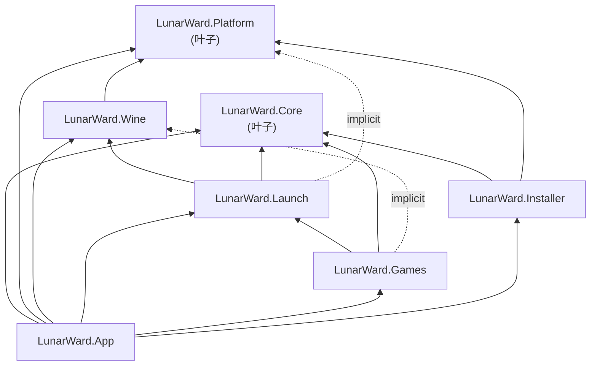

# 项目结构审计

审计对象：`/home/qie2035/projects/lunarward`，HEAD `d596a7a`，624 个受版本控制文件。
口径：只读静态分析（`.csproj` / `.slnx` / `Directory.Packages.props` / `git ls-files` + `wc -l` / grep），未编译、未运行。

## 1. 依赖图

`s` = 声明的 `ProjectReference`；`i` = 实际 `using` 但仅靠传递引用编译通过的**隐式**依赖。

| 引用方 | 被引用方 | 位置 | 性质 |
|---|---|---|---|
| App | Core, Platform, Wine, Launch, Games, Installer | `src/LunarWard.App/LunarWard.App.csproj:31-36` | s（全引用） |
| Games | Launch, Core | `src/LunarWard.Games/LunarWard.Games.csproj:6-7` | s |
| Installer | Core, Platform | `src/LunarWard.Installer/LunarWard.Installer.csproj:6-7` | s |
| Launch | Wine, Core | `src/LunarWard.Launch/LunarWard.Launch.csproj:15-16` | s |
| Launch | Platform | — 无 ProjectReference | **i**：`LaunchEngine.cs:2`、`PlayTimeService.cs:2`、`DailyNoteService.cs:7`、`ScreenshotService.cs:2` |
| Games | Wine | — 无 ProjectReference | **i**：`GameAdapter.cs:1` |
| Games | Microsoft.Data.Sqlite | — 无 PackageReference | **i**：`GameAccountStore.cs:190` |
| Wine | Platform | `src/LunarWard.Wine/LunarWard.Wine.csproj:6` | s |
| Core / Platform | —（叶子） | 无引用、无包 | s |

**无项目级循环**：Core、Platform 是纯叶子，不存在「Core→App」「Platform→Launch」这类反向边。问题不在环，而在**层级职责错位**与**隐式传递依赖**（见 PS-01/PS-02）。

## 2. 结论摘要

1. **没有循环依赖，但依赖方向靠「巧合」维持**：4 处 `using` 只因为上层恰好引用了传递程序集才编译通过，任何一次 csproj 整理都会连锁编译失败，且无法按层单测。
2. **`LunarWard.Launch` 已演变成「Launch 引擎 + 数据层 + 抽卡 + UIGF + 时长 + 截图 + 每日委托」的杂物间**（27 文件 / 7083 行），`Games` 因此被迫引用 `Launch` 仅为拿 5 个 SQLite store 里的基类——这是本次最严重的结构问题。
3. **App 占全仓 70.3%（51456 / 73142 行）**，其中 4 个 `Services/` 文件职责明确属于下层（`WineRegistry`→Wine、`GameScanner`→Games、`GameUninstaller`→Installer、`ReleaseChecker` 与 Core 的 `MetadataClient` 重复），属于长期下沉债。
4. **同一职责存在两份实现**：卸载（`Installer/GameUninstallService.cs` 无调用者 vs `App/Services/GameUninstaller.cs` 在用）、`ColorRectChart`（`App.Controls` 的 `Border` 版与 `Views/Starward/Controls` 的 `Control` 版同名共存），这是移植期并行重写的典型残留。
5. **包引用有 6 个死条目**（Markdig、Serilog.Extensions.Logging、Configuration.Binder、Configuration.Json、Avalonia.Diagnostics、Avalonia.Controls.ItemsRepeater），其中 `ItemsRepeater` 还是唯一跨出 Avalonia 12.1.4 版本族的包（12.0.0）。
6. **仓库卫生已达标准**：`bin/obj/artifacts` 零误提交、`.gitignore` 覆盖 `artifacts/`、工作区干净；待决策的只有 `docs/audit/`（现在既未跟踪也未忽略）。

## 3. 问题清单

### PS-01（P1）`LunarWard.Launch` 职责过载，`Games` 反向耦合
- 证据：`Launch` 27 文件 / 7083 行，混合 5 类关注点——相位引擎 `LaunchEngine.cs:737`、持久化 `Database/`（5 文件 1622 行，`GachaLogStore.cs:488` / `SelfQueryLogStore.cs:411` / `LunarWardDatabase.cs:349`）、抽卡导出 `Gacha/` 370 + `Uigf4/` 841、运行时长 `PlayTimeService.cs`、截图 `ScreenshotService.cs`、每日委托 `DailyNoteService.cs`；`Games/GameAccountStore.cs:2` 仅为 `LunarWardDatabase` 而 `using LunarWard.Launch.Database`。
- 影响：`Launch` 的抽卡/截图改动会波及 `Games` 与 `App` 的编译单元；数据层无法被 `Installer`/`Games` 独立引用；打包时 `MiniExcel` 被 `Launch` 的导出功能带进运行依赖。
- 建议：新增 `LunarWard.Data`（SQLite store + 迁移，依赖 `Microsoft.Data.Sqlite` 与 `Core`），`Launch` 只留相位/进程/时长，抽卡与 UIGF 移到 `LunarWard.Gacha`（或 `Core.Gacha` 之上的 `Launch.Gacha`）。先做「`Database/` 抽库」这一步即可消掉 `Games→Launch` 这条唯一的语义耦合。

### PS-02（P1）4 处隐式传递依赖，层次约束不可验证
- 证据：上表 3 条 `i` 行 + `Games/GameAdapter.cs:1`；`Launch.csproj` 无 `Platform` 引用，但 4 个文件 `using LunarWard.Platform`；`Games.csproj` 无 `Microsoft.Data.Sqlite`，却在 `GameAccountStore.cs:190` 直接用 `SqliteDataReader`。
- 影响：删除/新增任一 ProjectReference 会产生与改动无关的编译错误；`dotnet test` 无法按层切片；Code Review 无法用 csproj 判断合法依赖。
- 建议：把上述 4 条改成显式声明（`Launch` 加 `Platform`、`Games` 加 `Wine` + `Microsoft.Data.Sqlite`），并在 CI 加一条「`using LunarWard.X` 必须在本项目引用闭包内」的脚本检查（可复用现成的 `scripts/`）。

### PS-03（P1）App 过胖，`Services/` 混入下层职责
- 证据：App 186 文件 / 51456 行 = 全仓 70.3%；`Services/` 16 文件 3940 行里 `GameScanner.cs:432`（已 `using LunarWard.Games`）、`WineRegistry.cs:366`（`wine reg` CLI 封装）、`GameUninstaller.cs:200`（卸载逻辑属 Installer）、`ReleaseChecker.cs:142`（与 `Core/Metadata/MetadataClient.cs:120` 的 `GetGithubLatestReleaseAsync` 重复实现）明显错位。
- 影响：App 无法做无 UI 的集成测试；同一能力两处维护（`ReleaseChecker` 与 `MetadataClient` 会漂移）。
- 建议：按「谁拥有领域知识谁实现」下沉——`WineRegistry`→`LunarWard.Wine`、`GameScanner`/`GameSettingRegistry`→`LunarWard.Games`、`GameUninstaller`→`LunarWard.Installer`、`ReleaseChecker` 删除并改用 `Core.Metadata`。下沉后 App 只保留编排与 UI（目标 App ≤ 60%）。

### PS-04（P2）P/Invoke 越出 Platform 层
- 证据：`src/LunarWard.Installer/HardLink.cs:31` `[DllImport("libc", EntryPoint = "link")]`、`src/LunarWard.Installer/DriveHelper.cs:368` `[DllImport("libc", EntryPoint = "statx")]`；约定明写于 `src/LunarWard.Platform/Unix/Libc.cs:7`「上层（Wine / Launch / Games）不允许再写 DllImport」，且 `HardLink.cs:13-16` 自己承认「应上提为 `LunarWard.Platform.Unix.Libc.Link`」。
- 影响：`statx` 结构体布局与平台假设分散，AOT/裁剪与跨架构移植时两处各自出错；与其它 P/Invoke 的 `LibraryImport`（源生成）风格不一致（这两处是旧式 `DllImport`）。
- 建议：`link` 与 `statx` 上提到 `Platform/Unix/Libc.cs`，Installer 侧改为调用封装；顺带补一条静态检查（`grep DllImport src/ | 仅允许 Platform/`）。

### PS-05（P2）同一职责两份实现
- 证据：(a) 卸载——`src/LunarWard.Installer/GameUninstallService.cs:11`（`internal class`，唯一调用点是自己，`InstallMessages.cs:172` 的 `UninstallGameRequest` 也只被它使用）vs 实际在跑的 `src/LunarWard.App/Services/GameUninstaller.cs`（`GameLauncherSettingDialog.axaml.cs:517,:536,:553`、`UnitTests/GameUninstallerTests.cs`）；(b) 图表控件——`App/Controls/ColorRectChart.cs:21` `sealed class ColorRectChart : Border`（配 `ChartLegend`，`TravelersDiaryPage.axaml` 用）与 `App/Views/Starward/Controls/ColorRectChart.cs:15` `sealed class ColorRectChart : Control`（配 `IncomeSeriesItem`，`InterKnotMonthlyReportPage.axaml`、`TrailblazeCalendarPage.axaml` 用）同名共存。
- 影响：卸载逻辑修一处漏一处（Installer 版有截图备份/根目录校验，App 版是后写的 Linux 等价物，行为必然分叉）；同名控件让 grep/导航失效，样式无法复用。
- 建议：卸载保留一份并移入 Installer（App 只调用）；`ColorRectChart` 合并为一实现 + 两个数据模型，目录只留 `Views/Starward/Controls`。

### PS-06（P2）遗留 UI 死代码
- 证据：`Views/GachaWindow.axaml(.cs)` + `ViewModels/GachaViewModel.cs` 在自己之外零引用；`Views/ScreenshotWindow.axaml(.cs)` 零引用（`ScreenshotViewModel` 仍活，被 `ViewModels/Starward/ScreenshotPageViewModel.cs:36` 复用）。`Views/` 根目录 7 个旧窗口与 `Views/Starward/` 新树并存，`ShellWindow` 仍被 `SettingToolboxViewModel.cs:77` / `GameSettingPageViewModel.cs:1423` 使用，并且是 `Iciclecreek.Avalonia.Terminal` 的唯一使用者。
- 影响：新人无法判断哪套 UI 是正典；每多留一个窗口就多一份 XAML 编译与资源文件。
- 建议：删 `GachaWindow`/`GachaViewModel`/`ScreenshotWindow`；`ShellWindow` 若被「环境/诊断」入口长期依赖，移到 `Views/Starward/Legacy/` 并加 `Obsolete` 注记，顺带评估 `Iciclecreek` 包是否可随之下线。

### PS-07（P2）死包引用与版本族不一致
- 证据：`Directory.Packages.props` 声明 23 个包，其中 6 个在 `src/` 全量 grep 中零 API 命中——`Markdig`、`Serilog.Extensions.Logging`（`LogService` 用裸 `Serilog.LoggerConfiguration`，见 `Services/BackgroundService.cs:265`）、`Microsoft.Extensions.Configuration.Binder`（只用 `AsEnumerable()`/`AddIniStream`）、`Microsoft.Extensions.Configuration.Json`、`Avalonia.Diagnostics`、`Avalonia.Controls.ItemsRepeater`；后者的版本 **12.0.0** 是唯一偏离 Avalonia **12.1.4** 族的包，且仓库里连一处 `ItemsRepeater` 使用都没有（只有 `ImaginariumTheaterPage.axaml:300`、`SimulatedUniversePage.axaml:146` 的注释）。
- 影响：多还原 6 个包（含 `Markdig` 这类仅 App 使用的纯托管库）；Avalonia 12.0.0 与 12.1.4 混用是运行时类型加载/样式解析的隐患源，只是当前未真正使用才没爆。
- 建议：删 6 个 `PackageReference` + 6 个 `PackageVersion`；若真要用 `ItemsRepeater`，钉到 `12.1.4` 与族对齐。

### PS-08（P2）命名空间与目录不一致（17/453 文件）
- 证据（脚本全量比对 `namespace` 与目录）：(a) 11 个 `App/ViewModels/Starward/Settings/*.cs` 声明 `LunarWard.App.ViewModels.Starward`（缺 `.Settings`），而同层视图 `App/Views/Starward/Settings/*` 声明 `LunarWard.App.Views.Starward.Settings`——**两侧不对称**；(b) 6 个 `Core/GameRecord/ZZZ/ShiyuDefense/V2/*.cs` 声明 `...ShiyuDefense`（缺 `.V2`）；(c) `App/Services/CaptureMode.cs` 声明 `namespace LunarWard.App`（缺 `.Services`）。
- 影响：`using` 推断错误、IDE 的「移动到命名空间」与 ReSharper 分析噪声；XAML `x:DataType` 依赖全名，改名即破。
- 建议：一次性对齐（Settings 的 11 个文件 + V2 的 6 个 + CaptureMode），并在 `.editorconfig` 中开 `dotnet_style_namespace_match_folder = true`（见 PS-13）。

### PS-09（P2）本地化双轨：Core 用 resx，App 用手写字典
- 证据：`Core/Localization` 14 文件 4705 行 = 13 个语种 `.resx` + `CoreLang.Designer.cs:657`（自动生成）；App 侧 `Localization/AppStrings.cs` 单文件 **2215 行**，`ZhCn` 字典在 `:24`、`EnUs` 在 `:1083`，共 2104 个键，且全仓 App 下无任何 `.resx`。
- 影响：语种覆盖从 13 掉到 2（移植缺口被掩盖在 2215 行常量里）；每次加文案要改两处字典 + 一个 2215 行文件，diff 噪声大；无法交给翻译流程。
- 建议：App 文案迁到 `AppStrings.resx`（或从 resx 生成强类型访问器），短期至少按页面拆成多个 `partial` 文件把 2215 行打散。

### PS-10（P2）测试结构：一个工程吃下全部，且绑定 WinExe
- 证据：`tests/LunarWard.UnitTests` 51 文件 / 7812 行 / 461 个 `[Fact]`+`[Theory]`，`csproj:12-17` 同时引用 Core/Platform/Wine/Launch/Games/**App**（`App` 是 `WinExe`，这也是 CI 必须装 `libx11/libice6/libsm6/libfontconfig1/libfreetype6` 的原因）；`IntegrationTests` 8 文件 1883 行、`Installer.UnitTests` 4 文件 629 行各自独立；fixture 无共享工程——`TempDirectory`（`UnitTests/TestDoubles.cs:67`）与 `Sandbox`/`FakeWine`（`IntegrationTests/Sandbox.cs:11`、`FakeWine.cs:152`）互不可见。
- 影响：任何 App 层 UI 依赖都会污染全部单测；461 个用例集中在一个程序集，测试并行度与故障定位都变差；新写跨层测试要复制目录/假进程工具。
- 建议：拆 `LunarWard.Core.Tests` / `LunarWard.Launch.Tests` / `LunarWard.App.Tests`（App.Tests 才引 App）；抽 `tests/LunarWard.Testing` 放 `TempDirectory`/`FakeWine`/`Sandbox`。

### PS-11（P3）移植资产的路径约定有三套，且校验器会静默兜底
- 证据：`scripts/port-from-starward.sh:17-24` 以 `STARWARD_SRC`（默认 `/home/qie2035/projects/csharp/Starward`）+ `"$STARWARD_SRC/$1"` 拼路径，调用方须给 `src/Starward/Features/...`；`docs/08-UI-PARITY.md` upstream 列却写裸文件名（如 `GameLauncherPage.xaml`(684)）——实测 26 个上游路径 token 中仅 1 个能在 `<upstream>/src/Starward` 下解析，25 个只能靠文件名递归搜索；`scripts/check-parity.py:44` 正是这样 `base.rglob(Path(path).name)` 兜底的，而仓库内 `ColorRectChart.cs` 是唯一重名 basename，一旦换成语义校验就会误配。
- 影响：parity 报告「全绿」有假象成分（无 `--upstream` 33 条、有 `--upstream` 59 条、0 missing 全靠文件名兜底）；新人照文档填路径大概率写错。
- 建议：`docs/08-UI-PARITY.md` 上游列统一改为 `<upstream>/src/Starward/...` 相对路径；`check-parity.py` 去掉 rglob 兜底或至少对重名 basename 报错。

### PS-12（P3）文档漂移
- 证据：`third_party/README.md:5` 称 `docs/02-ARCHITECTURE.md` 的目录树里仍写着 `third_party/Starward/` 子模块，但 `docs/02-ARCHITECTURE.md:84-85` 已改为 `third_party/` + `README.md  # 说明：按 §3.1 用 subtree，不建 submodule`。`third_party/` 本身按设计为空。
- 影响：读者以为存在上游子模块，实际 clone 后为空目录。
- 建议：改掉 README 这句（或改成「见 docs/02 §3.1」），保持单一事实源。

### PS-13（P3）构建配置：无 lint 门、属性重复、缺 SDK 锁定
- 证据：仓库无 `.editorconfig`、无 `global.json`；`TreatWarningsAsErrors=false`（`Directory.Build.props:9`）；`NoWarn` 一次性关掉 6 个可空性警告 + `CA1416`（`Directory.Build.props:15`）；`ManagePackageVersionsCentrally` 在 `Directory.Build.props:21` 与 `Directory.Packages.props:4` 重复声明；`ci.yml` 只 restore/build/test/check-parity，无 `dotnet format`、无警告门。
- 影响：PS-08 这类命名空间问题永远靠人肉发现；可空性警告被全局静音后，`CS8618` 在 App 里又单独关一次（`App.csproj:14`），新代码质量无护栏。
- 建议：加 `.editorconfig`（含 `namespace_match_folder`、`file_header_template` 可选）与 `global.json` 锁 SDK；把 `CA1416` 收窄为按项目关闭；CI 加 `dotnet format --verify-no-changes`（或至少 `--severity warn` 的 analyzer 门）。

### PS-14（P3）`docs/audit/` 归属未定
- 证据：`docs/audit/` 存在但为空，`git check-ignore -v docs/audit/05-structure.md` 返回 exit 1（未被忽略），也不在任何提交里；`git ls-files docs/` 为 15 个文件，均为人工维护文档。
- 影响：本次及后续审计报告会以未跟踪文件形式长期漂在 `git status` 里，或被误 `git add` 进无关 PR。
- 建议：**纳入版本库**（审计报告是决策证据，纯文本、体积极小），按 `docs/audit/NN-<主题>.md` 命名并在 `docs/README`（若有）列索引；仅把 `docs/audit/*.png`、`*.html` 这类导出物加入 `.gitignore`。若团队更希望审计只留在 issue 里，则加 `docs/audit/` 到 `.gitignore` 并删除本目录——二选一，不要悬空。

## 4. 包引用表

| 包 | 版本 | 被哪些项目引用 | 实际使用 | 建议 |
|---|---|---|---|---|
| Avalonia | 12.1.4 | App | 是 | 保留（注意提示词写的是 11，仓库实为 12） |
| Avalonia.Desktop | 12.1.4 | App | 是 | 保留 |
| Avalonia.Themes.Fluent | 12.1.4 | App | 是（`App.axaml:12`） | 保留 |
| Avalonia.Controls.ItemsRepeater | 12.0.0 | 无 | **否**（仅注释提及） | 删除；若要用则钉 12.1.4 |
| Avalonia.Diagnostics | 12.1.4 | 无 | **否**（无 `AttachDevTools`） | 删除（或改 `Condition="'$(Configuration)'=='Debug'"` 再引用） |
| CommunityToolkit.Mvvm | 8.4.2 | App | 是 | 保留（源生成器，无可替代） |
| LibVLCSharp | 3.10.2 | App | 是（`BackgroundService.cs`、`StarwardPage.cs`） | 保留 |
| LibVLCSharp.Avalonia | 3.10.2 | App | 是（`StarwardShell.axaml.cs`） | 保留 |
| Iciclecreek.Avalonia.Terminal | 4.1.0 | App | 仅旧 `ShellWindow`/`EnvironmentShellViewModel` | 随 PS-06 一起评估下线 |
| MS.Extensions.Configuration | 10.0.11 | Games, Installer | 是（`GameConfigIni.cs:185,212`、`GameInstallService.cs:876`） | 保留 |
| MS.Extensions.Configuration.Ini | 10.0.11 | Games, Installer | 是（`AddIniFile`/`AddIniStream`） | 保留 |
| MS.Extensions.Configuration.Binder | 10.0.11 | Games | **否**（无 `Bind`/`Get<T>`） | 删除 |
| MS.Extensions.Configuration.Json | 10.0.11 | 无 | **否**（无 `AddJsonFile`） | 删除 |
| Polly | 8.8.0 | Installer | 是（`GameInstallService.cs`、`InstallerHttpClientFactory.cs`） | 保留；BCL 无等价重试策略，但注意与 `Core` 里自研的 `TokenBucketRateLimiter` 风格不统一 |
| ZstdSharp.Port | 0.8.8 | Installer | 是（Sophon 清单/包服务） | 保留（BCL 无 zstd） |
| Serilog.Extensions.Logging | 10.0.0 | App | **否**（`LogService` 直接 `new LoggerConfiguration()`） | 删除 |
| Serilog.Sinks.File | 7.0.0 | App | 是（`Services/BackgroundService.cs:249-269`） | 保留（BCL 无滚动文件 sink） |
| Markdig | 1.4.2 | App | **否**（全仓零命中） | 删除 |
| Microsoft.Data.Sqlite | 10.0.13 | Launch（Games 隐式用） | 是（5 个 store + `GameAccountStore` + `CaptureMode`） | 保留；显式加到 Games（PS-02） |
| MiniExcel | 1.46.0 | Launch | 是（`GachaExport.cs`、`GachaExcelExport.cs`、`GachaPageViewModel.cs`） | 保留（BCL 无 xlsx）；若抽 `LunarWard.Gacha` 则随之移动 |
| Microsoft.NET.Test.Sdk | 18.0.1 | 3 个测试工程 | 是 | 保留（与 net10 匹配） |
| xunit | 2.9.3 | 3 个测试工程 | 是（461 个用例） | 落后：可迁 `xunit.v3`（3.x） |
| xunit.runner.visualstudio | 3.1.5 | 3 个测试工程 | 是 | 与 `xunit` 2.9.3 跨大版本；要么升 v3 统一，要么钉回 2.8.x 同代 |

结论：23 个包里 6 个应删、1 个版本族不一致（`ItemsRepeater`）、1 组测试包跨大版本（`xunit` v2 + runner v3）。MS.Extensions.* 全族 10.0.11 一致，无版本漂移。

## 5. 大文件清单与拆分建议

`src/**/*.cs` + `src/**/*.axaml` 共 27 个文件 >600 行（`wc -l`）：

| 行数 | 文件 | 拆分方向 |
|---|---|---|
| 2215 | `App/Localization/AppStrings.cs` | 按页面拆 `partial`（Launcher/Settings/Gacha/Record）+ 迁 resx（PS-09） |
| 1786 | `App/ViewModels/Starward/GameLauncherPageViewModel.cs` | 拆「安装进度」「版本检查」「启动参数」「账号/区服」四个子 VM，主 VM 只做聚合 |
| 1673 | `App/ViewModels/Starward/GameSettingPageViewModel.cs` | 按设置分区拆（画面/音频/启动/兼容），与 `Views/Starward/Settings/*` 一一对应 |
| 1098 | `App/Views/Starward/GameLauncherSettingDialog.axaml.cs` | 卸载/修复/移动目录三段抽成 `DialogActions` 服务（顺带修 PS-05） |
| 1078 | `Installer/GameInstallHelper.cs` | 按「解包 / 补丁 / 校验」拆 |
| 1068 | `Core/GameRecord/HyperionClient.cs` | 按 API 族拆（角色/深渊/活动），提取公共请求管线 |
| 1046 | `Installer/GamePackageService.cs` | 拆 manifest 解析 / 下载 / 组装 |
| 1037 | `App/Views/Starward/Pages/Record/ShiyuDefensePage.axaml` | 拆 `UserControl` 子视图（关卡卡片、统计条），与 `ShiyuDefensePageViewModel.cs:1014` 同步 |
| 1014 | `App/ViewModels/Starward/ShiyuDefensePageViewModel.cs` | 拆数据聚合与展示状态 |
| 999 | `Core/GameRecord/HoyolabClient.cs` | 同 `HyperionClient`，两条 client 建议抽公共基类 |
| 955 | `App/ViewModels/Starward/ShellViewModel.cs` | 拆导航 / 窗口状态 / 全局命令 |
| 946 | `App/Views/Starward/Pages/GameLauncherPage.axaml` | 拆「游戏卡片」「启动栏」子视图 |
| 929 | `Installer/GameInstallService.cs` | 与 `GameInstallHelper` 边界重划（服务编排 vs 算法） |
| 917 | `App/ViewModels/Starward/GachaPageViewModel.cs` | 拆统计/筛选/导入导出 |
| 912 | `App/Views/Starward/Pages/GameSettingPage.axaml` | 按分区拆 `UserControl`（与 1673 行 VM 对应） |
| 737 | `Launch/LaunchEngine.cs` | 随 PS-01 拆出「进程监控」「阶段状态机」 |
| 736 | `Games/WineAccountService.cs` | 拆注册表读写 / 凭据转换 |
| 697 | `Core/HoYoPlay/HoYoPlayClient.cs` | 拆游戏配置 / 下载清单 |
| 685 | `App/Views/Starward/Pages/GameLauncherPage.axaml.cs` | 事件处理下沉到 VM（当前 code-behind 偏厚） |
| 684 | `Core/GameRecord/GameRecordClient.cs` | 拆响应反序列化与业务映射 |
| 672 | `App/Views/Starward/Pages/Record/DeadlyAssaultPage.axaml` | 与 `ShiyuDefensePage` 共用关卡卡片控件 |
| 657 | `Core/Localization/CoreLang.Designer.cs` | 自动生成，不手动拆；确保 `AutoGen` 头与 CI 校验一致 |
| 657 | `App/ViewModels/Starward/SelfQueryPageViewModel.cs` | 拆查询/结果表格/导出 |
| 623 | `App/ViewModels/Starward/ImaginariumTheaterPageViewModel.cs` | 拆关卡数据与筛选 |
| 612 | `App/Views/Starward/ImageViewWindow2.axaml.cs` | 手势/缩放逻辑抽 `ImageZoomController` |
| 603 | `Installer/DriveHelper.cs` | 抽 `statx` 到 Platform（PS-04）后再拆挂载/空间计算 |
| 601 | `App/Views/Starward/Pages/Record/ApocalypticShadowPage.axaml` | 同 Record 页族共用子视图 |

共性建议：Record 页族 4 个 axaml（601–1037）+ 4 个 VM 结构高度相似，先抽 1 个 `RecordPageBase` + 2 个共享 `UserControl`，可直接消掉约 1500 行重复；`HyperionClient`/`HoyolabClient` 再抽一层请求基类。axaml 总量 15869 行，其中 >500 行的还有 `PureFictionPage` 521、`ImaginariumTheaterPage` 518、`GachaPage` 502、`ForgottenHallPage` 487、`Styles/Starward.axaml` 472。

## 6. 建议修复批次

**批次 A —— 零风险清理（约 0.5 天，可单独 PR）**
1. 删 6 个死包（PS-07），`ItemsRepeater` 若要留则钉 12.1.4。
2. 删 `Views/GachaWindow.axaml(.cs)` + `ViewModels/GachaViewModel.cs` + `Views/ScreenshotWindow.axaml(.cs)`；删 `Installer/GameUninstallService.cs` + `Installer/InstallMessages.cs:172` 的 `UninstallGameRequest`（PS-05/PS-06）。
3. 修 `third_party/README.md:5` 的文档漂移（PS-12）；决定 `docs/audit/` 去留（PS-14，建议纳入版本库）。

**批次 B —— 让依赖显形 + 目录对齐（1–2 天）**
4. 补显式引用：`Launch→Platform`、`Games→Wine`、`Games→Microsoft.Data.Sqlite`（PS-02）。
5. 把 `Database/` 5 个 store 抽成 `LunarWard.Data`，消除 `Games→Launch`（PS-01 第一步）。
6. 修 17 处命名空间（PS-08）；App `Services/` 四个错位文件下沉（PS-03）。

**批次 C —— 结构性重构（2–4 天，按 PR 拆）**
7. `Launch` 拆为 `Launch`（相位/进程/时长）+ `Gacha`（抽卡/UIGF/Excel）+ `Data`（PS-01 收尾）。
8. `ColorRectChart` 合一（PS-05b）；卸载实现收敛到 Installer（PS-05a）。
9. 大文件拆分：优先 `GameLauncherPageViewModel`、`GameSettingPageViewModel`、`AppStrings`、Record 页族（PS-09/第 5 节）。
10. `statx`/`link` 上提到 Platform（PS-04）。

**批次 D —— 守门（持续）**
11. 加 `.editorconfig`（`namespace_match_folder`）+ `global.json`；CI 加 `dotnet format --verify-no-changes`，把 `CA1416` 收窄（PS-13）。
12. `check-parity.py` 去掉 rglob 静默兜底，`docs/08-UI-PARITY.md` 上游列改全路径（PS-11）。
13. 拆测试工程 + 抽 `LunarWard.Testing`（PS-10）。

建议顺序：A（立即，风险最低）→ B（下一迭代，消除最痛的隐式依赖）→ D 的 11/12（与 B 同批，防止新债）→ C（有余力再动，逐文件小 PR）。
